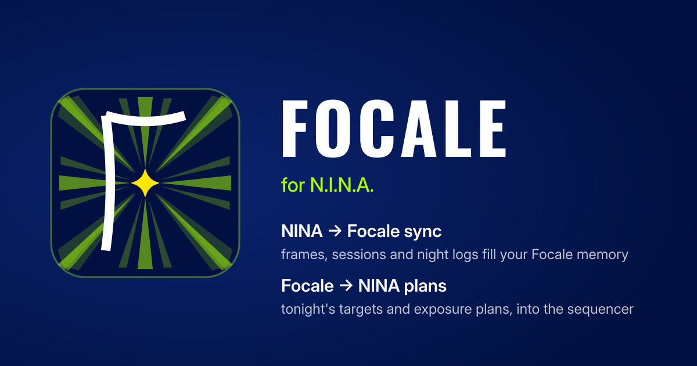

# Focale for N.I.N.A.

A NINA plugin that connects N.I.N.A. to [Focale](https://focale.space), both ways:

| | Direction | What | Plan |
|---|---|---|---|
| **NINA → Focale sync** | up, to the cloud | Every frame NINA saves, the night's sessions and logs fill your Focale memory as you capture. | Observer and above |
| **Focale → NINA plans** | down, to the rig — and back | Tonight's targets and exposure plans from Focale, added to NINA's Advanced Sequencer; each target tells Focale when it starts and finishes. | Imager and above |

(Focale's pricing table called them "NINA import" and "NINA push".)

## NINA → Focale sync

- **Frames** — every FITS or XISF frame NINA saves goes to Focale, which reads the header and files it under the right night, site, telescope, camera and target, as an observation or a calibration frame, with image metrics computed server-side. NINA's TIFF and RAW saves are skipped.
- **Where the pixels go** — chosen in the settings page, once; nothing is uploaded until then:
  - *Index only*: each frame is sent to Focale, which reads and measures it, then discards it. Nothing is kept but the metadata and measurements (no storage used); your copy stays on your computer. The upload is the same size as with the other choices.
  - *Focale storage*: a copy is kept in Focale (counts against your plan's storage).
  - *My own storage*: a copy goes to one of your Focale-connected storages (S3, SFTP, SMB, FTP, or Dropbox connected with "Connect Dropbox"), as `Focale/<the frame's path below NINA's image folder>` under the storage's root — NINA's own date/target/… folders are kept, and Focale's scans of that storage skip the `Focale/` folder.
- **Night events** — the sequence, autofocus runs (position, temperature, filter; failed runs too), meridian flips, guiding RMS over each exposure, dithers, park/unpark and safety changes are recorded as they happen and filed under the night log Focale put that night's frames in. They make the session timeline of Focale's Logbook. Can be turned off.
- **Durable queues** — frames and events are kept on disk (SQLite) and survive network drops and NINA restarts. While you are offline, signed out, over a plan limit, or your chosen storage is refused, they wait and go up once that clears. A frame is only given up when Focale refuses that specific file, or when it was deleted or modified before it was sent.

## Focale → NINA plans

- **Focale → NINA plans panel** — a dock panel in NINA lists tonight's plan from Focale's Tonight: each target with its time and exposure lines (filter × exposure × count, binning). Pick one of your own NINA target templates once; "Add" builds a target from it — the template is cloned, its target set (name, J2000 coordinates, position angle), and its Smart Exposures replaced by one per planned line (filters matched by name in your filter wheel, never guessed) — and adds it to the Advanced Sequencer. "Add all" does the whole night. Nothing changes in your sequence unless you click. Gain and offset come from the template. Anyone can read their plan in the panel; writing exposure plans in Focale's Tonight needs Imager, so on Observer each target keeps the template's exposures.
- **What ran goes back to Focale** — each target the panel builds starts with a *Focale: mark active* step and ends with *Focale: mark done*, so Focale's Tonight shows the entry as active while NINA images it and done once its target container finishes (the panel shows the status on refresh, and "Add all" skips entries already done or skipped). The steps never fail or slow down the sequence: the status is sent in the background, and while you are offline or signed out the latest one per entry waits and goes later (until NINA closes). A target stopped or skipped in NINA before its end stays active. The steps keep their entry when you save the sequence; picked by hand from the sequencer's Focale category, they are not linked to an entry and do nothing.

The plugin does not send NINA profiles, settings or log files. Smart scheduling is the next phase.

## Your plan

After you sign in, the settings page shows your Focale plan (Free, Observer, Imager or Pro, read from your profile's `focale_tier`) and what it includes, with an **Upgrade** button below Imager. On Free, frames wait in the queue rather than being sent and refused; the plan is read again every 15 minutes, and at once with **Check my plan again** or **Resume** after you upgrade.

## Status

Version 1.0.0, submitted to the NINA plugin registry. Works with NINA 3.2 and 3.3: the shipped build targets .NET 8 against NINA 3.2, which NINA 3.3 (.NET 10) loads as well; CI also compiles the code against NINA 3.3 so an API change there breaks the build. See [BUILD.md](BUILD.md) for build/test instructions and [ENDPOINT_MAPPING.md](ENDPOINT_MAPPING.md) for how the plugin maps NINA concepts onto the Focale API.

## Install

> Once released, the plugin will be installable from the NINA plugin manager (Options → Plugins → Available). For now, manual install:

1. Download the latest release zip from the GitHub Releases page.
2. Extract into `%LOCALAPPDATA%\NINA\Plugins\<NINA-major.minor.patch>\Focale\`.
3. Restart NINA.
4. Open Options → Plugins → Focale and sign in with your Focale email (or username) and password.
5. Choose where your frames go. To use Focale → NINA plans, open the panel from NINA's Imaging tab.

## Authentication & privacy

- The plugin signs in with your Focale email or username and password, and receives a JWT access/refresh pair. The password is never stored. The access token lives in memory only and is auto-refreshed; the refresh token is the long-lived secret and is stored **encrypted at rest** using Windows DPAPI (`DataProtectionScope.CurrentUser`) in `%LOCALAPPDATA%\NINA\PluginData\Focale\account.json`, shared by all your NINA profiles. When it expires or is revoked, the settings page asks you to sign in again; frames wait meanwhile.
- The storage choice and the features belong to each NINA profile, so two rigs can send their frames to different places.
- The plugin sends `X-Focale-Client: nina-plugin` on every request. Server-side, that gives the plugin its own session bucket — revoking the plugin from your account settings does **not** affect your web/desktop sessions, and vice-versa.
- All HTTPS calls use the .NET default TLS stack with certificate validation enabled. The plugin never disables TLS verification.
- Only the saved image files and, if enabled, the night's events (times, autofocus positions, guiding RMS, …) are sent — no NINA profile, settings or log files. Nothing leaves your machine until you sign in and choose where frames go.
- Transient HTTP errors and network drops are retried silently; the plugin does **not** spam UI toasts. A plan or quota refusal (HTTP 402/403/507, e.g. the plan's indexed-files or storage limit) or a refused destination storage pauses the queue for an hour, with the reason and a **Resume** button in the plugin's settings page.

## License

MPL 2.0 — same as N.I.N.A. itself. See [LICENSE](LICENSE).
